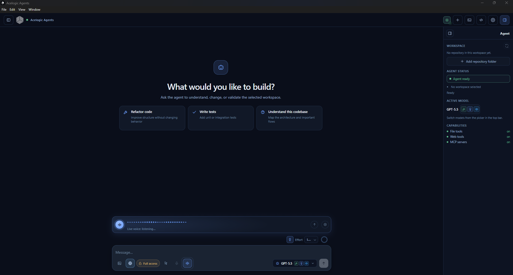
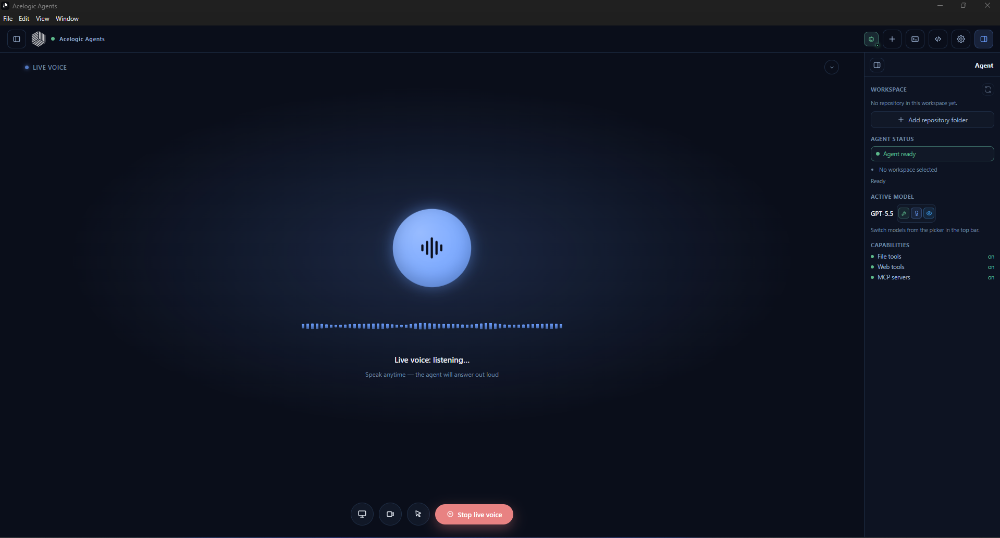

# Acelogic Agents — Releases

<p align="center">
  
</p>

<p align="center">
  <a href="https://github.com/acelogicg/Acelogic-Agents-Releases/releases/latest"><b>⬇ Unduh versi terbaru</b></a>
  &nbsp;·&nbsp; Windows 10/11 (x64)
</p>

Acelogic Agents adalah coding agent desktop yang bekerja langsung di folder proyek Anda: membaca kode, mengedit file, menjalankan perintah, dan memakai Git. Model bisa dari LM Studio atau llama.cpp di komputer sendiri, OpenAI API, atau akun ChatGPT Plus/Pro. Sejak versi 1.0.4, agent juga bisa diajak bicara, melihat layar dan kamera Anda, dan mengoperasikan komputer.

Repositori ini hanya berisi installer resmi. Kode sumber aplikasi tidak disimpan di sini.

*English summary at the [bottom of this page](#english).*

## Unduh

Ambil versi terbaru di halaman **[Releases](https://github.com/acelogicg/Acelogic-Agents-Releases/releases/latest)**.

| Sistem | File |
|---|---|
| Windows 10/11 (x64) | `Acelogic-Agents-<versi>-x64-Setup.exe` |
| Linux (x64) | `Acelogic-Agents-<versi>-x86_64.AppImage` atau `.deb` (jika tersedia di rilis tersebut) |

## Baru di 1.0.16

- **Agent bekerja sampai selesai.** Tidak lagi berhenti setelah menyebut langkah berikutnya atau memberi balasan kosong, dan koneksi yang putus dicoba ulang dengan pesan yang jelas.
- **Nama model di setiap balasan**, jadi jelas model mana yang menulisnya.
- Ganti model di tengah chat kini ikut mengganti batas konteks dan pemadatan otomatis; balasan panjang OpenAI/ChatGPT tidak lagi terputus setelah 5 menit.

## Baru di 1.0.15

- **Skill desain baru:** identitas brand, design system, styling UI (shadcn/ui, Tailwind), presentasi HTML, dan banner, lengkap dengan script dan datanya.
- **Skill bawaan lengkap.** Skill UI/UX dan pembuat skill kini menyertakan data dan script, jadi fiturnya benar-benar jalan.
- Skill bawaan Word, PDF, PowerPoint, dan Excel dihapus; agent tetap bisa mengolah berkas tersebut dengan tool standar.

## Baru di 1.0.14

- **Header kustom** untuk provider OpenAI-compatible di Settings → Koneksi, untuk layanan yang butuh header sendiri seperti `X-Api-Key` atau `api-key`.
- **OpenAI jadi satu provider** dengan pilihan metode masuk: *API key* atau *Akun ChatGPT (OAuth)*.
- **Kode dari agent lebih baik.** Mengikuti gaya proyek yang sudah ada, tanpa secret di kode, dan tidak commit atau deploy tanpa diminta. Skill bawaan baru membantu menyusun struktur proyek backend, frontend, dan mobile.
- **Settings → Preferensi** menggantikan nama *Perilaku*.

## Baru di 1.0.13

- **Lampirkan berkas apa pun.** Tombol penjepit kertas, drag & drop, atau paste ke composer, sampai 8 lampiran. Berkas teks dikirim bersama pesan, berkas besar atau biner (PDF, ZIP, Word…) dibaca agent lewat path-nya.
- **Pembersihan cache otomatis** setiap 30 hari (bisa diatur 7–90 hari), plus tombol *Bersihkan sekarang* di Settings → Perilaku. Chat, memori, dan model suara tetap aman.
- **Salin kode sekali klik.** Tombol *Salin* di blok kode, dan kode atau command inline tinggal diklik untuk disalin.
- **Link di jawaban bisa diklik** dan terbuka di browser default.

## Baru di 1.0.12

- **Tahu kenapa agent berhenti.** Kalau provider AI menolak permintaan, chat sekarang menjelaskan penyebabnya dan apa yang perlu dilakukan: kena rate limit (termasuk berapa lama harus menunggu), kuota atau saldo habis, API key ditolak, model tidak ditemukan, percakapan melebihi batas konteks, atau server model tidak bisa dihubungi. Pesan asli dari provider tetap ditampilkan di bawahnya.
- **Status saat mencoba ulang.** Selama runtime menunggu provider pulih, status bar menampilkan alasannya, misalnya *Kena rate limit provider — mencoba lagi dalam 18 dtk*, jadi agent tidak terlihat diam saja.
- **Jawaban ChatGPT/OpenCode tidak lagi hilang.** Di pesan kedua dan seterusnya dalam satu sesi, jawaban model kadang tidak sampai ke layar walaupun sudah selesai dibuat. Sekarang selalu tampil. Jika model benar-benar selesai tanpa jawaban, chat memberi tahu.
- **Hapus koneksi OpenAI-compatible.** Tombol *Hapus koneksi* di Settings → Koneksi membuang URL dan token yang tersimpan, termasuk sisa pengaturan dari versi lama.
- **Runtime lebih sabar di komputer lambat.** Batas waktu menyalakan runtime OpenCode naik dari 15 menjadi 90 detik, untuk komputer yang dipindai antivirus saat pertama kali dibuka.
- **Agent mengenal fitur aplikasinya sendiri.** Ditanya soal suara, agent kini menunjuk tombol dikte dan live voice, bukan menjawab fitur itu tidak ada.

## Baru di 1.0.5

- **Transkripsi lewat Cloudflare Workers AI.** Pilihan baru di Settings → Suara bagi komputer tanpa GPU: Whisper berjalan di Cloudflare, tanpa unduhan model. Isi Account ID dan API token (izin Workers AI), lalu pilih `whisper-tiny-en`, `whisper`, atau `whisper-large-v3-turbo`. Biaya sekitar $0,0005 per menit audio, ditagih oleh Cloudflare. Jika permintaan gagal, aplikasi otomatis kembali ke model lokal.
- **Pilih mikrofon.** Jika komputer punya lebih dari satu mikrofon, pilih yang dipakai untuk live voice dan dikte. Bila mikrofon itu dicabut, bawaan sistem dipakai sampai perangkatnya tersambung lagi.
- **Suara Bahasa Indonesia asli di Windows.** Suara OneCore seperti *Microsoft Andika* kini bisa dipilih sebagai suara pembaca, jadi jawaban tidak lagi dibacakan dengan aksen asing. Aplikasi memberi tahu jika paket suara Indonesia belum terpasang.
- **Deteksi ucapan lebih andal.** Noise latar dan suara pelan dibedakan lebih baik, sehingga live voice lebih jarang terpicu oleh bunyi sekitar atau memotong kalimat Anda.
- **Kontrol perangkat multi-monitor.** Screenshot, klik, drag, dan scroll bisa diarahkan ke monitor mana pun, termasuk dengan skala DPI berbeda.
- **Tool `run_command`.** Saat kontrol perangkat aktif di Full akses, agent bisa menjalankan perintah PowerShell di seluruh komputer, bukan hanya di workspace.
- **Pindah jendela lebih andal.** Jika Windows menolak memindahkan fokus (misalnya ke jendela milik Administrator), agent berhenti dan memberi tahu, alih-alih mengetik ke jendela yang salah.

## Baru di 1.0.4

- **Live voice layar penuh.** Orb dan 56 bar gelombang bergerak mengikuti volume mikrofon Anda, dengan warna berbeda saat mendengar, mentranskripsi, menunggu agent, dan membacakan jawaban. Transkrip ucapan Anda dan jawaban agent tampil di bawahnya. Tekan `Esc` untuk mengecilkannya menjadi panel di atas kolom chat.
- **Potong agent kapan saja.** Mulai bicara saat agent sedang membacakan jawaban, dan suaranya langsung berhenti untuk mendengarkan Anda.
- **Agent melihat layar dan kamera.** Dengan tombol *Bagikan layar* dan *Kamera*, gambar terbaru ikut terkirim setiap kali Anda selesai bicara. Butuh model yang bisa membaca gambar.
- **Kontrol perangkat (Windows).** Agent bisa mengambil screenshot, klik, drag, scroll, mengetik, menekan shortcut (`ctrl+c`, `alt+tab`, `win+d`), membuka dan menutup aplikasi, berpindah jendela, mengatur volume dan media, mengunci layar, serta membaca atau mengisi clipboard. Setiap giliran, agent tahu jendela mana yang sedang aktif. Perintah "buka YouTube" setelah "buka Google" memakai tab yang sama, tidak membuat tab baru.
- **Mode izin Read-only / Full akses** di toolbar chat. Read-only memblokir penulisan file, perintah shell, server MCP buatan pengguna, dan semua aksi perangkat; agent hanya bisa membaca dan melihat. Full akses menjalankan semuanya tanpa konfirmasi.
- **Pilihan suara pembaca** di Settings → Suara: perempuan, laki-laki, atau suara lain yang terpasang di sistem (misalnya aksen Inggris-Britania, Inggris-India, atau Indonesia). Tersedia gaya Normal, Tenang, Ceria, Berat, Cepat, dan Pelan, slider kecepatan dan nada, serta tombol dengar contoh di setiap suara.
- **Transkripsi lebih akurat.** Pilih model Whisper Base, Small, atau Large v3 Turbo; pilihan Otomatis memakai Turbo bila GPU mendukung. Tersedia juga deteksi bahasa otomatis untuk kalimat campuran Indonesia dan Inggris. Jawaban panjang kini dibacakan sampai selesai.

## Semua fitur

### Agent di workspace Anda

- Membaca, mencari (glob dan grep), mengedit, dan menulis file, lalu menjalankan build atau test lewat shell dan memperbaiki error yang muncul sampai lolos.
- Rencana kerja yang terlihat di atas kolom chat, subagent untuk tugas paralel, dan progres live dalam token/detik.
- Beberapa folder workspace sekaligus, panel Git (status, branch, checkout), terminal terintegrasi, dan riwayat sesi yang bisa disimpan lalu dibuka lagi.
- Konteks dipadatkan otomatis saat pemakaian mencapai 75%, memori agent per workspace, dan instruksi kustom yang berlaku di semua percakapan.
- Pengaturan reasoning effort dan tombol thinking untuk model yang mendukung, serta lampiran hingga 4 gambar untuk model vision.

### Provider model

- **Kompatibel OpenAI:** LM Studio, llama.cpp, vLLM, atau router model apa pun, dengan base URL dan token opsional. Daftar model dibaca otomatis dari `/v1/models`.
- **OpenAI API key** untuk memakai model OpenAI langsung.
- **ChatGPT Plus/Pro:** login lewat browser, tanpa API key.
- Web search dan web fetch bisa diaktifkan dari toolbar chat, dan tetap berjalan untuk model lokal tanpa API key pencarian.

### Skill, pencarian semantik, dan MCP

- **39 skill bawaan** yang dimuat otomatis saat relevan, antara lain frontend-design, ui-ux-pro-max, react, nodejs, python, api-design, database-design, devops, testing, webapp-testing, mcp-builder, docx, pptx, xlsx, pdf, dan data-analysis. Anda juga bisa menambahkan skill sendiri.
- **Embedding** (default Jina `jina-embeddings-v3`) memilih 5 skill paling relevan per pesan dan memberi agent tool `semantic_search` untuk mencari kode berdasarkan makna, bukan hanya kata yang persis sama.
- **Server MCP** lewat stdio, HTTP, atau SSE. Konfigurasi bisa diimpor sekali klik dari Claude Code, Claude Desktop, Cursor, atau Windsurf, dan `.mcp.json` per proyek ikut dibaca.

### Suara

<p align="center">
  
</p>

- **Dikte:** klik mikrofon, bicara, lalu hasil transkripsi masuk ke kotak pesan dan bisa diedit sebelum dikirim.
- **Live voice:** percakapan tanpa tangan. Jeda bicara otomatis mengirim pesan, jawaban dibacakan, lalu mikrofon mendengar lagi.
- Pengenalan suara berjalan **lokal di perangkat** memakai Whisper (WebGPU bila tersedia, CPU sebagai cadangan). Audio Anda tidak dikirim ke layanan transkripsi, kecuali Anda memilih Cloudflare. Model diunduh sekali dari Hugging Face saat fitur suara pertama kali dipakai.

### Tampilan dan pembaruan

- Enam tema: Dark, Light, Midnight, Forest, Ocean, dan Sunset. Antarmuka tersedia dalam bahasa Indonesia dan Inggris.
- Pembaruan otomatis: aplikasi mengecek halaman Releases ini 10 detik setelah dibuka lalu setiap 4 jam, mengunduh versi baru di latar belakang, dan menawarkan **Restart & perbarui**. Jika tidak di-restart, pembaruan dipasang saat aplikasi ditutup.

## Instalasi

**Windows:** jalankan `Setup.exe`, pilih folder instalasi, lalu buka Acelogic Agents dari Start Menu atau shortcut desktop.

**Linux (AppImage)**

```bash
chmod +x Acelogic-Agents-*.AppImage
./Acelogic-Agents-*.AppImage
```

**Linux (deb)**

```bash
sudo apt install ./Acelogic-Agents-*.deb
```

## Catatan penting

- **Kontrol perangkat hanya aktif saat tombol kursor di toolbar dinyalakan**, dan mengikuti mode izin. Di Full akses, agent bisa mengklik dan mengetik tanpa bertanya. Jendela yang berjalan sebagai Administrator tidak bisa dikendalikan. Mouse, keyboard, dan jendela saat ini hanya didukung di Windows.
- **Kamera dan layar** hanya dikirim ke provider model yang Anda pakai, dan hanya saat tombolnya aktif.
- **Suara pembaca** memakai suara bawaan sistem operasi. Untuk menambah suara dan aksen di Windows, buka Settings → Time & language → Speech, lalu buka ulang aplikasi.
- **Transkripsi terbaik** membutuhkan GPU. Tanpa GPU, pilih model Seimbang (Whisper Small).
- File `latest.yml`, `latest-linux.yml`, dan `.blockmap` di setiap rilis dipakai oleh pembaruan otomatis. Jangan dihapus.

---

## English

Acelogic Agents is a desktop coding agent that works inside your project folder: it reads code, edits files, runs commands, and uses Git, with models from LM Studio, llama.cpp, the OpenAI API, or a ChatGPT Plus/Pro account. This repository only hosts the official installers.

### New in 1.0.16

- **The agent works until it is done.** It no longer stops after announcing its next step or returning an empty reply, and dropped connections are retried with a clear message.
- **Model name on every reply**, so it is clear which model wrote it.
- Switching models mid-chat now updates the context limit and automatic compaction; long OpenAI/ChatGPT replies are no longer cut off after 5 minutes.

### New in 1.0.15

- **New design skills:** brand identity, design systems, UI styling (shadcn/ui, Tailwind), HTML presentations, and banners, with their scripts and data.
- **Complete built-in skills.** The UI/UX and skill-creation skills now include their data and scripts, so their features actually run.
- The built-in Word, PDF, PowerPoint, and Excel skills were removed; the agent still handles these files with standard tools.

### New in 1.0.14

- **Custom headers** for OpenAI-compatible providers in Settings → Connection, for services that need their own header such as `X-Api-Key` or `api-key`.
- **OpenAI is one provider** with a sign-in choice: *API key* or *ChatGPT account (OAuth)*.
- **Better code from the agent.** Follows your project's existing style, keeps secrets out of code, and makes no commits or deploys unless asked. A new built-in skill helps structure backend, frontend, and mobile projects.
- **Settings → Preferences** replaces the *Behavior* name.

### New in 1.0.13

- **Attach any file.** Paperclip button, drag & drop, or paste into the composer, up to 8 attachments. Text files go with the message; large or binary files (PDF, ZIP, Word…) are read by the agent from their path.
- **Automatic cache cleanup** every 30 days (7–90 days configurable), plus a *Clean now* button in Settings → Behavior. Chats, memory and the voice model are kept.
- **One-click code copy.** A *Copy* button on code blocks, and inline code or commands copy with a click.
- **Clickable links** in replies open in your default browser.

### New in 1.0.12

- **Clear provider errors.** When the AI provider rejects a request, the chat explains why and what to do: rate limit (with the wait time), exhausted quota or credit, rejected API key, unknown model, context overflow, or an unreachable model server.
- **Retry status.** While a runtime waits for the provider to recover, the status bar shows the reason, with a countdown when the provider gives one.
- **ChatGPT/OpenCode replies no longer go missing** on follow-up messages in a session.
- **Delete the saved OpenAI-compatible connection** from Settings → Connection.
- **Slower machines start reliably.** The OpenCode runtime now gets 90 seconds to start instead of 15.

### New in 1.0.5

- **Cloudflare Workers AI transcription** for machines without a GPU, with automatic fallback to the local Whisper model.
- **Microphone picker** for live voice and dictation.
- **Native Indonesian reader voice on Windows** through OneCore voices such as Microsoft Andika.
- **More reliable speech detection** that ignores background noise and cuts sentences off less often.
- **Multi-monitor device control** and a `run_command` tool that runs PowerShell anywhere on the computer (Full access only).

### New in 1.0.4

- **Full-screen live voice.** A mic-reactive orb and waveform, a live transcript, and the ability to interrupt the agent by speaking over it.
- **Screen and camera sharing.** The latest frame is sent with each thing you say.
- **Device control on Windows.** Screenshots, clicks, typing, shortcuts, opening and closing apps, switching windows, volume and media keys, the clipboard, and locking the screen. The agent knows the active window, so "open YouTube" reuses the current browser tab.
- **Read-only / Full access permission modes.** Read-only blocks file writes, shell commands, user MCP servers, and every device action at the runtime level.
- **Reader voice picker.** Choose female, male, or any installed voice and accent, six speaking styles, and speed and pitch sliders.
- **More accurate on-device speech recognition.** Choose Whisper Base, Small, or Large v3 Turbo, with automatic language detection for mixed Indonesian and English.

**Everything else:** file and shell tools with plan tracking and subagents, multiple workspace folders, Git, a built-in terminal, saved sessions, and auto context compaction. You also get 39 bundled skills, embedding-based skill routing and `semantic_search`, MCP servers over stdio, HTTP, or SSE with one-click import from Claude Code, Claude Desktop, Cursor, and Windsurf, web search that works with local models, six themes, and silent auto-updates.
